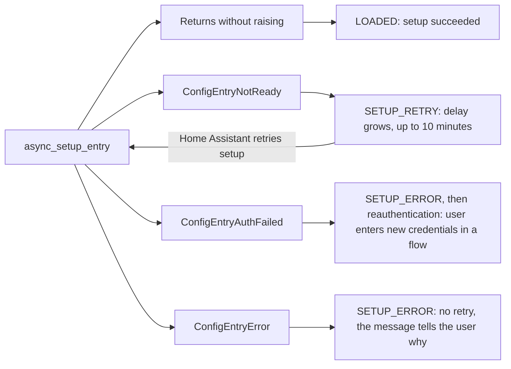

# Home Assistant Custom Integration Guidelines

Checked against the [Home Assistant developer docs](https://contributors.home-assistant.io/) on 2026-11-02.

## How to use this guideline

A custom integration is built the same way as a core one, so the core rules below apply. [What differs](https://contributors.home-assistant.io/marketplace/guides/integrations/) is mainly the manifest (`version`, `issue_tracker`, your own `documentation`), translations and brand images.

Each section gives the rules that cause real failures when skipped. Inline links jump to the exact passage on the developer site. The last section, Further reading, lists every other page by topic, with when you need it. Those pages carry equal weight once your integration uses that feature.

This was checked against the developer docs on the date above. The docs describe a moving API, so recheck version-dependent items before relying on them.

## Repository, domain and manifest

Get these right first, because the domain can never change and Home Assistant reads the manifest before any code.

- **One repository, one integration.** Keep everything the integration needs inside [`custom_components/<domain>/`](https://contributors.home-assistant.io/marketplace/guides/integrations/#put-it-in-its-own-repository). Files outside that folder are not installed.
- **Pick a domain no core integration uses.** A matching domain [overrides the built-in integration](https://contributors.home-assistant.io/core/integrations/file-structure/#where-home-assistant-looks-for-integrations), and the user stops getting its updates. The catalog [rejects integrations that do this](https://contributors.home-assistant.io/marketplace/guides/integrations/#pick-a-domain-that-is-yours).
- **Follow the file names.** Home Assistant finds features by name, such as [`config_flow.py`, `diagnostics.py` and `services.yaml`](https://contributors.home-assistant.io/core/integrations/file-structure/). Put the coordinator in `coordinator.py` and the base entity in `entity.py`.
- **Ship finished translations.** Custom integrations [do not use `strings.json`](https://contributors.home-assistant.io/marketplace/guides/integrations/#translations). Ship `translations/en.json` complete. Core docs that say `strings.json` mean this file for you. Write every string in full, because references like \[%key:...%\] are not replaced here and users would see the raw text.
- **Ship your own brand images.** Put them in a [`brand/` folder](https://contributors.home-assistant.io/core/integrations/file-structure/#brand-images-in-custom-integrations) inside the integration, and do not use Home Assistant branded images.
- **Run the validators on every push.** The [hassfest and HACS GitHub Actions](https://contributors.home-assistant.io/marketplace/guides/integrations/#check-it-in-your-repository) must both pass to enter the catalog.
- **Write tests.** Cover at least every path of the config flow: success, each error, each abort and a duplicate setup. See [writing tests](https://contributors.home-assistant.io/core/development/tests/).

### Manifest keys

Hassfest requires `domain`, then `name`, then everything else alphabetically. The [manifest reference](https://contributors.home-assistant.io/core/integrations/manifest/) has every key.

| Key | Rule for a custom integration |
| --- | --- |
| `domain` | Lowercase letters, numbers and underscores. Must match the folder name. |
| `name` | The product or service name users see. |
| `version` | Required. AwesomeVersion format, the same as your release tag. |
| `documentation` | Required. Your own docs, over https. |
| `issue_tracker` | Where users report bugs. HACS requires it for the catalog. |
| `codeowners` | At least your own GitHub handle. |
| `iot_class` | Required if it connects to anything. How it talks to the device or service. |
| `integration_type` | Set it: `device`, `hub`, `service` or `helper`. Missing means `hub`. |
| `config_flow` | `true` when you have a `config_flow.py`. |
| `single_config_entry` | `true` when only one entry makes sense. |
| `requirements` | Exact pins (`==`). Do not list what Home Assistant already requires. |
| `dependencies` | Integrations you cannot work without. |
| `after_dependencies` | Integrations you can use if present. Also list what you import from. |
| `loggers` | Logger names your libraries use, so debug logging reaches them. |

## Config flow and config entries

Users set up an integration that talks to a device or service in the UI, and it must recover and reload without a restart.

### The flow

- **Use a config flow, not YAML.** [Device and service integrations are UI only](https://contributors.home-assistant.io/core/integrations/yaml/#when-yaml-is-allowed). Helpers may also use YAML. If you have an `async_setup`, [define `CONFIG_SCHEMA`](https://contributors.home-assistant.io/core/integrations/yaml/#integrations-without-yaml), usually `cv.config_entry_only_config_schema(DOMAIN)`.
- **Test the connection before creating the entry.** On failure, return the form with `errors["base"]` set. See the [flow example](https://contributors.home-assistant.io/core/integrations/config-flow/#add-a-config-flow).
- **Prevent duplicates.** Call `async_set_unique_id`, then `_abort_if_unique_id_configured`. If your devices have no unique ID, read [discovery without a unique ID](https://contributors.home-assistant.io/core/integrations/config-flow/#discovery-without-a-unique-id).
- **Use a stable ID.** [Good sources](https://contributors.home-assistant.io/core/integrations/config-flow/#what-makes-a-good-unique-id) are a serial number or a MAC address passed through `format_mac`. Never use an IP address, device name, URL or changeable hostname.
- **Always confirm discovered devices.** [A discovery step must never create an entry by itself](https://contributors.home-assistant.io/core/integrations/config-flow/#discovery-steps).

### Where data lives

| Place | What belongs there | How it changes |
| --- | --- | --- |
| `entry.data` | What is needed to connect: host, token | [Reconfigure or reauth flow](https://contributors.home-assistant.io/core/integrations/reauth-reconfigure/) |
| `entry.options` | How the integration behaves. Not the polling interval. | [Options flow](https://contributors.home-assistant.io/core/integrations/options-flow/) |
| `entry.runtime_data` | Client and coordinator while running. Not stored. | Set in `async_setup_entry` |

Do not keep entry data in `hass.data`. [`runtime_data` is cleaned up with the entry](https://contributors.home-assistant.io/core/integrations/config-entries/#keep-runtime-data-in-runtime_data), and type checkers understand it. Declare a typed alias such as `type ExampleConfigEntry = ConfigEntry[ExampleCoordinator]`.

### The lifecycle

- **Set up in order.** Create the client, do the first refresh, set `runtime_data`, then call [`async_forward_entry_setups`](https://contributors.home-assistant.io/core/integrations/config-entries/#set-up-the-platforms).
- **Support unloading.** Implement [`async_unload_entry`](https://contributors.home-assistant.io/core/integrations/config-entries/#unload-a-config-entry) with `async_unload_platforms_or_raise`. Enabling an entity [reloads the entry](https://contributors.home-assistant.io/core/entities/registry/#disabled-entities), so this is not optional in practice.
- **Register cleanup when you create the resource.** Use `entry.async_on_unload(...)` for listeners and connections, and [`entry.async_create_background_task`](https://contributors.home-assistant.io/core/integrations/config-entries/#background-tasks) for long-running tasks.
- **Never set `ConfigEntry` attributes directly.** Call [`async_update_entry`](https://contributors.home-assistant.io/core/integrations/config-entries/#change-a-config-entry), which saves the change and tells listeners.
- **Version stored data.** When its shape changes, bump `VERSION` or `MINOR_VERSION` and [implement `async_migrate_entry`](https://contributors.home-assistant.io/core/integrations/config-entries/#migrate-a-config-entry). Check the version before each step, and leave entries you do not know alone.
- **Prefer exceptions over `False`.** Custom integrations [may still return a boolean](https://contributors.home-assistant.io/core/integrations/config-entries/#return-values-in-custom-integrations), but `False` shows users only a generic message.

### Changing an entry later

- **Offer reauthentication.** Raise `ConfigEntryAuthFailed` [from `async_setup_entry` or the coordinator](https://contributors.home-assistant.io/core/integrations/reauth-reconfigure/#start-it). Raised elsewhere, it does not start the flow.
- **Check it is the same account or device.** In reauth and reconfigure, call `_abort_if_unique_id_mismatch`, then `async_update_reload_and_abort`. Calling `async_create_entry` in these flows raises an error.
- **Pick one way to apply options.** Use `OptionsFlowWithReload` or an update listener. [Combining them raises an error](https://contributors.home-assistant.io/core/integrations/options-flow/#act-on-new-options).

## Async and thread safety

One blocking call stalls all of Home Assistant, because almost everything runs in a single event loop thread.

- **Never block the loop.** Network and disk I/O, sleeping and heavy computation all block. Use an async library and `await` it, or hand the call to [`hass.async_add_executor_job`](https://contributors.home-assistant.io/core/internals/asyncio/#move-blocking-work-to-the-executor).
- **Do no I/O in properties.** [Properties are called on every state write](https://contributors.home-assistant.io/core/entities/entity-class/#property-methods) and must return data from memory.
- **Mark sync handlers with `@callback`.** Without it, Home Assistant assumes the function blocks and runs it in a thread, where `async_` calls are unsafe. This is [the usual cause](https://contributors.home-assistant.io/core/internals/thread-safety/#the-usual-cause-a-missing-callback) of thread safety errors.
- **Match the API to the thread.** Use `async_` versions in the loop and [the versions without it](https://contributors.home-assistant.io/core/internals/thread-safety/#from-a-thread-what-to-call-instead) elsewhere. Registries and `async_update_entry` have no thread-safe version, so schedule them with `hass.add_job`.
- **Use the shared HTTP clients.** Use [`async_get_clientsession(hass)` or `get_async_client(hass)`](https://contributors.home-assistant.io/core/internals/blocking-operations/#ssl-load_default_certs-load_verify_locations-load_cert_chain-and-set_default_verify_paths). Creating your own SSL context reads certificates from disk in the loop.
- **Move file reads along with `open`.** Home Assistant [only detects the `open` call](https://contributors.home-assistant.io/core/internals/blocking-operations/#file-system-open-glob-walk-listdir-scandir-and-pathlib-reads-and-writes), so reads left behind block unnoticed. Calls like `os.path.exists` also go to the executor.
- **Import at module level.** This is [right for almost every integration](https://contributors.home-assistant.io/core/internals/blocking-operations/#import-at-module-level). A late import needs the executor or `async_import_module`.
- **Never wait on a coroutine from inside the loop.** `run_coroutine_threadsafe(...).result()` [deadlocks there](https://contributors.home-assistant.io/core/internals/asyncio/#call-async-code-from-a-thread).
- **Develop in debug mode.** Set `debug: true` under `homeassistant:` in `configuration.yaml`. It [reports thread safety and blocking errors with a stack trace](https://contributors.home-assistant.io/core/internals/asyncio/#find-mistakes-early).

## Fetching data and handling failures

Do not write retry loops. Raise the right exception, and Home Assistant retries, starts reauthentication or marks entities unavailable.

- **Keep protocol code in a library.** [The integration only translates](https://contributors.home-assistant.io/core/integrations/api-library/) between that library and Home Assistant. The library takes the session as an argument, stores no tokens, and raises separate auth and connection errors. The PyPI and licence requirements on that page apply to core.
- **Prefer push.** [Use it when the API supports it](https://contributors.home-assistant.io/core/integrations/fetching-data/#push-or-poll), and set `iot_class` to match.
- **Use one coordinator when one request serves many entities.** Pass `config_entry`, and [extend `CoordinatorEntity`](https://contributors.home-assistant.io/core/integrations/fetching-data/#entities-that-use-the-coordinator) so polling and availability are handled. Timeouts and aiohttp client errors are handled too.
- **Do the first refresh during setup.** Call [`async_config_entry_first_refresh`](https://contributors.home-assistant.io/core/integrations/fetching-data/#do-the-first-refresh-during-setup) before forwarding platforms. It works only from `async_setup_entry`, and entities then always start with data.
- **Pick the polling interval yourself.** It is [not a user option](https://contributors.home-assistant.io/core/integrations/options-flow/). Too low costs resources, can overload the device, and [can get users blocked by cloud APIs](https://contributors.home-assistant.io/core/integrations/fetching-data/#poll-per-entity).
- **Set `PARALLEL_UPDATES` in every platform.** Use [`0` for read-only platforms on a coordinator](https://contributors.home-assistant.io/core/integrations/fetching-data/#parallel-requests), and `1` when a device handles one request at a time.

### Which exception to raise

| Exception | Raise it from | When | Result |
| --- | --- | --- | --- |
| `ConfigEntryNotReady` | `async_setup_entry` | Offline or not ready yet | Retries with a growing delay, up to 10 minutes |
| `ConfigEntryAuthFailed` | `async_setup_entry`, coordinator | Credentials no longer work | Starts a reauthentication flow |
| `ConfigEntryError` | `async_setup_entry` | A retry will not fix it | `SETUP_ERROR`, no retry |
| `UpdateFailed` | Coordinator | One update failed | Entities unavailable, tries again next interval |
| `ServiceValidationError` | Actions, entity methods | The user did something wrong | Error shown to the caller |
| `HomeAssistantError` | Actions, entity methods | Anything else failed | Error shown to the caller |

A failed first coordinator refresh raises `ConfigEntryNotReady` for you, so you rarely raise it by hand.

- **Raise setup exceptions from `__init__.py`.** [Raised in a platform's `async_setup_entry`](https://contributors.home-assistant.io/core/integrations/setup-failures/#during-setup), they are only logged and that platform is skipped. There is no retry and no reauthentication.
- **Do not log what Home Assistant already logs.** It logs setup retries. Coordinators log a failure once, not on every poll. Entities that manage their own availability should [log the first failure and once on recovery](https://contributors.home-assistant.io/core/entities/state-updates/#availability).
- **Honour rate limits.** [Pass `retry_after`](https://contributors.home-assistant.io/core/integrations/setup-failures/#wait-before-retrying) when the service says when it is available again.
- **Translate messages.** Use `translation_domain` and `translation_key`, so the [message users see](https://contributors.home-assistant.io/core/integrations/setup-failures/#the-message) explains what actually went wrong.

## Entities and devices

Users build automations and dashboards on entities, so identity must stay stable and state must stay honest.

### Identity

- **Pick the platform that matches the real thing.** [A valve is a valve and a light is a light](https://contributors.home-assistant.io/core/entities/#picking-the-right-platform), even if both only turn on and off. Do not work around a missing feature with attributes.
- **Give every entity a unique ID.** Without one there is [no registry entry](https://contributors.home-assistant.io/core/entities/registry/#unique-id), so users cannot rename, move or disable it. Combine the device ID with a key, such as `f"{serial}_{description.key}"`, and leave out your domain.
- **Never let that ID change.** Changing it creates a new entity and loses the user's settings. Never use an IP address, hostname, URL, device name, email address or username. An email can identify a cloud config entry, but not an entity.
- **Migrate when you must change it.** Use [`er.async_migrate_entries`](https://contributors.home-assistant.io/core/integrations/entity-registry/#migrate-unique-ids) in `async_migrate_entry`, with a major version bump.
- **Never build or assume an entity ID.** Users can change them. [Look them up by unique ID](https://contributors.home-assistant.io/core/integrations/entity-registry/#look-up-entities) in the registry.
- **Name entities in context.** Set [`has_entity_name = True`](https://contributors.home-assistant.io/core/entities/naming/#use-has_entity_name) and a `translation_key`. Use `_attr_name = None` for a device's main feature, and leave the name unset to inherit it from the device class.
- **Group entities under devices.** Set [`device_info`](https://contributors.home-assistant.io/core/entities/registry/#linking-to-a-device) with `identifiers` or `connections`. This works only for entities with a unique ID that belong to a config entry.
- **Let users remove stale devices.** Implement [`async_remove_config_entry_device`](https://contributors.home-assistant.io/core/integrations/device-registry/#let-users-remove-devices), or nobody can delete them from the UI.
- **Classify entities.** Use a device class wherever one fits. Set [an entity category](https://contributors.home-assistant.io/core/entities/registry/#entity-categories) for config and diagnostic entities, and [disable noisy ones by default](https://contributors.home-assistant.io/core/entities/registry/#enabled-and-visible-by-default).

### State

- **Use the states your platform defines.** If `on` and `off` are the states, [do not invent `running`](https://contributors.home-assistant.io/core/entities/state-attributes/#the-state). A state holds at most 255 characters.
- **Separate unavailable from unknown.** Set `available` to `False` when you cannot get data. [Return `None` when the value is just missing](https://contributors.home-assistant.io/core/entities/state-updates/#availability).
- **Write state only after a command succeeded.** If it fails, raise and leave the state alone. Then [choose by device behaviour](https://contributors.home-assistant.io/core/entities/state-updates/#after-a-command): wait for the push, request a refresh, or update optimistically.
- **Keep attributes few and stable.** Fast-changing values [work better as their own sensor](https://contributors.home-assistant.io/core/entities/state-attributes/#extra-state-attributes), and static device facts belong in device info. Every attribute change is a database row and a state change event.
- **Keep expected attributes present.** [An expected attribute is always in the dictionary](https://contributors.home-assistant.io/core/entities/state-attributes/#attributes-dont-come-and-go), with `None` when it has no value.
- **Keep the database small.** Exclude attributes with the class attribute [`_unrecorded_attributes`](https://contributors.home-assistant.io/core/entities/state-attributes/#keep-attributes-out-of-the-history). Above 16 KiB, all attributes of that state are dropped from the recorder.
- **Prefer icon translations.** Use [`icons.json`](https://contributors.home-assistant.io/core/entities/icons/#icon-translations) over the `icon` property, so icons stay out of the state object. Keep the default icon when it fits.

### Lifecycle

- **Keep `__init__` small.** [`self.hass` and `self.entity_id` are not set yet](https://contributors.home-assistant.io/core/entities/lifecycle/#adding-an-entity) at that point.
- **Subscribe in `async_added_to_hass`.** Clean up with [`self.async_on_remove(...)`](https://contributors.home-assistant.io/core/entities/lifecycle/#async_on_removefunc) so you never leak a listener, and call `super()` when you inherit from classes such as `CoordinatorEntity`.
- **Expect entities that never run.** [Disabled entities are never added](https://contributors.home-assistant.io/core/entities/registry/#disabled-entities), so keep references to entities only from `async_added_to_hass`.
- **Do not rely on removal hooks at shutdown.** [Stopping Home Assistant removes no entities](https://contributors.home-assistant.io/core/entities/lifecycle/#removing-an-entity). Listen for `EVENT_HOMEASSISTANT_STOP` instead.
- **Handle entity ID changes.** Custom integrations [must opt in to in-place changes until 2027.11](https://contributors.home-assistant.io/core/entities/lifecycle/#async_entity_id_changedold_entity_id) by implementing `async_entity_id_changed`, if they use the add or remove hooks.

## Actions, events, repairs and diagnostics

These are how users call your integration and find out what went wrong, so failures must be visible and data must be safe to share.

### Actions

- **Register in `async_setup`.** [Not in `async_setup_entry` or a platform](https://contributors.home-assistant.io/core/integrations/actions/#register-actions-in-async_setup). Actions then exist with no entry loaded, so automations can still be validated.
- **Target the right level.** [Use entity, device or config entry](https://contributors.home-assistant.io/core/integrations/actions/#choose-the-right-target), whichever the action really acts on. Make the target required, because a default silently changes behaviour when a second device is added.
- **Use entity actions for entities.** Register them with [`async_register_platform_entity_service`](https://contributors.home-assistant.io/core/integrations/actions/#entity-actions) under your own domain. It resolves targets and checks permissions for you.
- **Always give a schema.** [Without one, `call.data` is whatever the caller sent](https://contributors.home-assistant.io/core/internals/actions/).
- **Raise errors, do not return them.** [Errors are always exceptions](https://contributors.home-assistant.io/core/integrations/actions/#return-response-data), never codes in response data. Do not return data that fits entity state.
- **Describe every action.** Put fields and selectors in [`services.yaml`](https://contributors.home-assistant.io/core/integrations/actions/#describe-actions-in-servicesyaml), names and descriptions in translations, and icons in `icons.json`.

### Events

- **Prefer event entities.** They are [the preferred way to offer device events](https://contributors.home-assistant.io/core/integrations/events/#make-device-events-available). New device automations are no longer accepted.
- **Do not fake events with state.** If you do fire bus events, name them `<domain>_event`, and [add `device_id`](https://contributors.home-assistant.io/core/integrations/events/#fire-events-on-the-bus) when one applies.
- **Use the event helpers.** They [call your code only for the changes you care about](https://contributors.home-assistant.io/core/integrations/events/#listen-to-home-assistant). Pass the returned function to `entry.async_on_unload` or `self.async_on_remove`.
- **Use `get_url` for callback addresses.** [Never build the instance URL yourself](https://contributors.home-assistant.io/core/integrations/instance-url/#the-get_url-helper), and ask for only the requirements you really need.

### Repairs and restarts

- **Raise repair issues for what users must act on.** Set [`config_entry_id`](https://contributors.home-assistant.io/core/integrations/repairs/#issues-that-belong-to-a-config-entry) on issues about one entry, and put the entry ID in `issue_id` if several entries can raise it.
- **Do not delete issues on unload.** A reload unloads too, so [every issue the user ignored comes back](https://contributors.home-assistant.io/core/integrations/repairs/#delete-an-issue). Delete an issue only when the problem is really gone.
- **Do not use a repair to ask for a restart.** Call [`async_set_home_assistant_restart_required`](https://contributors.home-assistant.io/core/integrations/restart-required/#anything-else) once the change is actually waiting.

### Diagnostics

- **Offer a download.** Add [`diagnostics.py`](https://contributors.home-assistant.io/core/integrations/diagnostics/#add-diagnostics). It is often the fastest way to see what is going on at a user's home.
- **Redact before you return.** Users post diagnostics in public issues. [Remove credentials, location and personal data](https://contributors.home-assistant.io/core/integrations/diagnostics/#leave-out-sensitive-data) with `async_redact_data`, then check the output by hand, because API data often holds more than you expect.

## Security, permissions and LLM tools

[Permissions only work if your code checks them](https://contributors.home-assistant.io/core/internals/permissions/) and keeps track of who asked.

- **Gate anything that changes configuration.** Normal users and administrators [control the same entities](https://contributors.home-assistant.io/core/internals/permissions/#policies), so admin rights are a separate check on `user.is_admin`.
- **Use the admin-only registration.** Use [`async_register_admin_service`](https://contributors.home-assistant.io/core/integrations/actions/#admin-only-actions) for actions and [`require_admin`](https://contributors.home-assistant.io/core/internals/websocket-api/#add-your-own-command) for WebSocket commands. In an [HTTP view](https://contributors.home-assistant.io/core/internals/permissions/#in-an-http-view), check `is_admin` and raise `Unauthorized`.
- **Pass the context on.** [The context carries the user](https://contributors.home-assistant.io/core/internals/permissions/#the-context-carries-the-user). Use `call.context`, `connection.context(msg)` or `self.context(request)` for everything you do on a user's behalf.
- **Check entities in plain actions.** A plain action that acts on entities must [call `check_entity` for each one](https://contributors.home-assistant.io/core/internals/permissions/#in-an-action). No `user_id` means the call came from Home Assistant itself.
- **Keep tokens out of history.** The recorder stores every attribute. Exclude tokens with [`_unrecorded_attributes`](https://contributors.home-assistant.io/core/entities/state-attributes/#keep-attributes-out-of-the-history), and redact them in diagnostics.
- **Use the OAuth helpers.** Home Assistant [handles the flow, storage and refresh](https://contributors.home-assistant.io/core/integrations/oauth2/). Every OAuth integration must support [application credentials](https://contributors.home-assistant.io/core/integrations/oauth2/#application-credentials).
- **Do not plan on a custom auth provider.** [Only built-in providers are supported](https://contributors.home-assistant.io/core/internals/auth/).

### If you offer LLM tools

- **Choose how to offer them.** [Contribute tools with an `llm.py` platform](https://contributors.home-assistant.io/core/internals/llm-api/#contribute-tools), or [build your own API](https://contributors.home-assistant.io/core/internals/llm-api/#build-your-own-api). The Assist API cannot do anything administrative, so return admin tools only for the right `api_id`.
- **Prefix contributed tools.** Names from `llm.py` must start with your domain and two underscores, such as `my_integration__coffee_count`.
- **Fill in the tool.** Set [`integration = DOMAIN`](https://contributors.home-assistant.io/core/internals/llm-api/#tools), and write `description` for the model, because the model is lost without it.
- **Declare annotations.** [The defaults assume the worst](https://contributors.home-assistant.io/core/internals/llm-api/#annotations): not read-only, destructive, not idempotent, open world.
- **Return `llm.ToolResult`.** [Raise `HomeAssistantError`](https://contributors.home-assistant.io/core/internals/llm-api/#calling-a-tool) when the tool cannot do its job.
- **Scope your own API.** Set `requires_admin=True` when only administrators may use it, and [unregister it with `entry.async_on_unload`](https://contributors.home-assistant.io/core/internals/llm-api/#build-your-own-api).
- **Assume it is reachable over MCP.** [Every registered API is served](https://contributors.home-assistant.io/core/internals/llm-api/#served-over-mcp) once the user sets up the MCP Server integration, with no work from you. All APIs except Assist need an administrator's token there.

## Release checklist and keeping up

The quality scale [has no tiers for custom integrations](https://contributors.home-assistant.io/marketplace/guides/integrations/#keep-up-with-home-assistant), but its rules are still a good guide. This checklist recommends the Bronze and Silver reliability rules for a first release, and Gold and Platinum as it matures. The [54 rules](https://contributors.home-assistant.io/core/quality-scale/rules/) are the full list.

### Before the first release

- [ ] Manifest has `version`, `documentation`, `issue_tracker`, `codeowners` and pinned `requirements`.
- [ ] Domain is unused by core, and the hassfest and HACS actions pass.
- [ ] `translations/en.json` is complete, with no `[%key:...%]` references.
- [ ] `brand/` images are your own.
- [ ] Config flow tests the connection and blocks duplicates, with every path tested.
- [ ] Setup checks the connection and raises the right exception.
- [ ] Client and coordinator live in `entry.runtime_data`.
- [ ] Every entity has a unique ID and `has_entity_name = True`.
- [ ] Entities subscribe in `async_added_to_hass` and clean up with `async_on_remove`.
- [ ] Actions are registered in `async_setup`, and raise exceptions when they fail.
- [ ] The entry unloads and reloads without a restart.
- [ ] Entities go unavailable when unreachable, logged once on loss and once on recovery.
- [ ] Every platform sets `PARALLEL_UPDATES`.
- [ ] Credentials can be replaced through a reauthentication flow.
- [ ] A run with `debug: true` reports no thread safety or blocking errors.
- [ ] Docs cover installation, setup fields, options, actions and removal.

### As it matures

- [ ] Entities are grouped in devices, and new devices appear without a reload.
- [ ] Stale devices are removed, or users can remove them.
- [ ] Diagnostics are available, and their output has been checked by hand.
- [ ] Devices are discovered where possible, and discovery updates a moved device's address.
- [ ] Users can reconfigure an entry without removing it.
- [ ] Problems users can fix raise repair issues.
- [ ] Entity names, errors and icons are translated.
- [ ] Entity categories, device classes and disabled-by-default are set.
- [ ] The library is async and takes the Home Assistant web session.
- [ ] Code passes strict typing.

Core's test helpers, such as `MockConfigEntry`, [live in core's `tests/common.py`](https://contributors.home-assistant.io/core/development/tests/#test-through-home-assistant). Outside core, the community package `pytest-homeassistant-custom-component` offers them. The developer docs do not cover that package.

### Keeping up

- **Test against the beta.** Changes to what custom integrations use from core are [deprecated for 12 months and announced on the blog](https://contributors.home-assistant.io/marketplace/guides/integrations/#keep-up-with-home-assistant). Set `homeassistant` in `hacs.json` when a release needs a newer version.
- **Protect user files.** An update replaces the whole integration folder. Keep files users need in one subfolder, named as [`persistent_directory`](https://contributors.home-assistant.io/marketplace/guides/integrations/#keep-user-files-across-updates) in `hacs.json`.

### Announced breaking changes

These are the dates stated on the pages read for this guideline. Soonest comes first.

| Home Assistant | What changes | What to do |
| --- | --- | --- |
| 2026.12 | Warning planned to become an error: a reconfigure, reauth or discovery flow reloading an entry that has an update listener | [Let the update listener do the reloading](https://contributors.home-assistant.io/core/integrations/options-flow/#act-on-new-options) |
| 2027.3 | `llm.py` tools without the `<domain>__` prefix stop working | [Rename the tools](https://contributors.home-assistant.io/core/internals/llm-api/#contribute-tools) |
| 2027.6 | `show_advanced_options` is removed | [Use a collapsed section](https://contributors.home-assistant.io/core/integrations/flow-steps/) |
| 2027.8 | `via_device` is removed. Device links stop for entities without a unique ID or config entry. | [Use `via_device_id`, and give entities both](https://contributors.home-assistant.io/core/entities/registry/#linking-to-a-device) |
| 2027.10 | LLM tools without `integration` stop working | [Set `integration = DOMAIN`](https://contributors.home-assistant.io/core/internals/llm-api/#tools) |
| 2027.11 | LLM tools returning a plain dictionary stop working | [Return `llm.ToolResult`](https://contributors.home-assistant.io/core/internals/llm-api/#calling-a-tool) |
| 2027.11 | The opt-in for in-place entity ID changes ends | [Implement `async_entity_id_changed`](https://contributors.home-assistant.io/core/entities/lifecycle/#async_entity_id_changedold_entity_id) |

## Further reading

Every page below is as binding as the rules above once your integration uses that feature. The first table adds pages the listed docs depend on. The rest cover the original list, with the duplicate area registry link merged.

### Start here for custom integrations

| Page | Read it when |
| --- | --- |
| [Publish a custom integration](https://contributors.home-assistant.io/marketplace/guides/integrations/) | Before anything else. It covers everything that differs from core. |
| [The manifest](https://contributors.home-assistant.io/core/integrations/manifest/) | You set any key in `manifest.json` or add a discovery matcher |
| [Translations](https://contributors.home-assistant.io/core/integrations/translations/#custom-integrations) | You add user-facing text. The linked section is the custom part. |
| [Brands and images](https://contributors.home-assistant.io/core/integrations/brands/) | You add an icon or logo |
| [Writing tests](https://contributors.home-assistant.io/core/development/tests/) | You plan tests, fixtures, mocks or snapshots |
| [All quality scale rules](https://contributors.home-assistant.io/core/quality-scale/rules/) | You want the full 54-rule checklist |
| [Input validation](https://contributors.home-assistant.io/core/development/input-validation/) | You write schemas |
| [Deprecating](https://contributors.home-assistant.io/core/development/deprecating/) | You plan or react to a breaking change |

### Getting started

| Page | Read it when |
| --- | --- |
| [Building integrations](https://contributors.home-assistant.io/core/integrations/) | You want the map of every integration topic |
| [How an integration fits in](https://contributors.home-assistant.io/core/integrations/concepts/) | You are new to entries, platforms, coordinators and the event loop |
| [Tutorial](https://contributors.home-assistant.io/core/integrations/tutorial/) | You want a complete worked example |
| [Build a Python library](https://contributors.home-assistant.io/core/integrations/api-library/) | You write the library behind the integration |
| [Create an integration](https://contributors.home-assistant.io/core/integrations/create/) | You want the smallest possible integration or the scaffold |
| [File structure](https://contributors.home-assistant.io/core/integrations/file-structure/) | You are unsure which file does what |
| [Quality scale](https://contributors.home-assistant.io/core/quality-scale/) | You want to know how the tiers work |

### Setup and configuration

| Page | Read it when |
| --- | --- |
| [Config entries](https://contributors.home-assistant.io/core/integrations/config-entries/) | You write setup, unload, removal or migration |
| [Config flow](https://contributors.home-assistant.io/core/integrations/config-flow/) | You write the setup dialog, unique IDs or discovery steps |
| [Forms, menus and progress](https://contributors.home-assistant.io/core/integrations/flow-steps/) | A flow needs more than a simple form |
| [Options flow](https://contributors.home-assistant.io/core/integrations/options-flow/) | Users can change behaviour after setup |
| [Subentries](https://contributors.home-assistant.io/core/integrations/subentries/) | An entry has repeatable parts, such as locations |
| [Reauthentication and reconfiguration](https://contributors.home-assistant.io/core/integrations/reauth-reconfigure/) | Credentials expire or connection details change |
| [OAuth 2.0](https://contributors.home-assistant.io/core/integrations/oauth2/) | Users link an account at a cloud service |
| [YAML configuration](https://contributors.home-assistant.io/core/integrations/yaml/) | You think you need YAML, or define `CONFIG_SCHEMA` |
| [Setup failures](https://contributors.home-assistant.io/core/integrations/setup-failures/) | You decide which exception to raise |

### Data, discovery and registries

| Page | Read it when |
| --- | --- |
| [Fetching data](https://contributors.home-assistant.io/core/integrations/fetching-data/) | You choose polling, push or a coordinator |
| [Events](https://contributors.home-assistant.io/core/integrations/events/) | You fire events or react to Home Assistant |
| [Instance URL](https://contributors.home-assistant.io/core/integrations/instance-url/) | A device or service must reach Home Assistant |
| [Discovery](https://contributors.home-assistant.io/core/integrations/discovery/) | Devices can be found automatically |
| [Network discovery](https://contributors.home-assistant.io/core/integrations/network-discovery/) | You use zeroconf, SSDP, DHCP, USB, MQTT or network APIs while running |
| [Bluetooth](https://contributors.home-assistant.io/core/integrations/bluetooth/) | The integration uses Bluetooth at all |
| [Bluetooth data](https://contributors.home-assistant.io/core/integrations/bluetooth-data/) | Entities come from Bluetooth advertisements |
| [Device registry](https://contributors.home-assistant.io/core/integrations/device-registry/) | You register, link, split or remove devices |
| [Entity registry (integrations)](https://contributors.home-assistant.io/core/integrations/entity-registry/) | You look up or migrate entities from code |
| [Area registry](https://contributors.home-assistant.io/core/integrations/area-registry/) | You want to suggest an area for a device |

### Integration features

| Page | Read it when |
| --- | --- |
| [Actions](https://contributors.home-assistant.io/core/integrations/actions/) | You register your own actions |
| [Triggers and conditions](https://contributors.home-assistant.io/core/integrations/triggers-and-conditions/) | You provide automation triggers or conditions |
| [Device automations](https://contributors.home-assistant.io/core/integrations/device-automations/) | You maintain existing device automations. New ones are not accepted. |
| [Diagnostics](https://contributors.home-assistant.io/core/integrations/diagnostics/) | Users should be able to download data for support |
| [System health](https://contributors.home-assistant.io/core/integrations/system-health/) | You want to show reachability or quota on the system page |
| [Repairs](https://contributors.home-assistant.io/core/integrations/repairs/) | Users must act on a problem, or a repair flow can fix it |
| [Asking for a restart](https://contributors.home-assistant.io/core/integrations/restart-required/) | A change only applies after a restart |
| [Reproduce state](https://contributors.home-assistant.io/core/integrations/reproduce-state/) | Scenes must work with an entity integration |
| [Significant change](https://contributors.home-assistant.io/core/integrations/significant-change/) | Exporters need to know which state changes matter |
| [Backup](https://contributors.home-assistant.io/core/integrations/backup/) | You store backups, or must prepare for one |
| [Media source](https://contributors.home-assistant.io/core/integrations/media-source/) | You expose browsable and playable media |

### Entity basics

| Page | Read it when |
| --- | --- |
| [Entities](https://contributors.home-assistant.io/core/entities/) | You choose a platform. It lists every platform. |
| [The entity class](https://contributors.home-assistant.io/core/entities/entity-class/) | You write any entity, or use entity descriptions |
| [Naming](https://contributors.home-assistant.io/core/entities/naming/) | You name an entity |
| [Updating state](https://contributors.home-assistant.io/core/entities/state-updates/) | You write polling, push, command or availability code |
| [Lifecycle](https://contributors.home-assistant.io/core/entities/lifecycle/) | You subscribe, clean up, restore state or track registry changes |
| [State and attributes](https://contributors.home-assistant.io/core/entities/state-attributes/) | You add an attribute |
| [Icons](https://contributors.home-assistant.io/core/entities/icons/) | The default icon does not fit |
| [Entity registry (entities)](https://contributors.home-assistant.io/core/entities/registry/) | You set unique IDs, device links or categories |

### Entity platforms

| Group | Pages |
| --- | --- |
| Voice and AI | [AI task](https://contributors.home-assistant.io/core/entities/ai-task/), [Assist satellite](https://contributors.home-assistant.io/core/entities/assist-satellite/), [Conversation](https://contributors.home-assistant.io/core/entities/conversation/), [Speech-to-text](https://contributors.home-assistant.io/core/entities/stt/), [Text-to-speech](https://contributors.home-assistant.io/core/entities/tts/), [Wake word](https://contributors.home-assistant.io/core/entities/wake-word/) |
| Controls | [Button](https://contributors.home-assistant.io/core/entities/button/), [Switch](https://contributors.home-assistant.io/core/entities/switch/), [Number](https://contributors.home-assistant.io/core/entities/number/), [Select](https://contributors.home-assistant.io/core/entities/select/), [Text](https://contributors.home-assistant.io/core/entities/text/), [Scene](https://contributors.home-assistant.io/core/entities/scene/) |
| Date and time | [Date](https://contributors.home-assistant.io/core/entities/date/), [Date and time](https://contributors.home-assistant.io/core/entities/datetime/), [Time](https://contributors.home-assistant.io/core/entities/time/) |
| Messages and lists | [Notify](https://contributors.home-assistant.io/core/entities/notify/), [To-do list](https://contributors.home-assistant.io/core/entities/todo/) |

Read the page for each platform you implement. Each one lists its properties, features, methods and states.

### How core works

| Page | Read it when |
| --- | --- |
| [How core works](https://contributors.home-assistant.io/core/internals/) | You want the map of the internals |
| [The hass object](https://contributors.home-assistant.io/core/internals/hass/) | You need `hass` or `hass.config` |
| [Event bus](https://contributors.home-assistant.io/core/internals/events/) | You need event internals or listen without helpers |
| [State machine](https://contributors.home-assistant.io/core/internals/states/) | You want to know what a state object holds |
| [Action registry](https://contributors.home-assistant.io/core/internals/actions/) | You call actions from code or write handlers |
| [Async](https://contributors.home-assistant.io/core/internals/asyncio/) | You write any integration code. Read it early. |
| [Thread safety](https://contributors.home-assistant.io/core/internals/thread-safety/) | You get a thread safety report, or use a sync library |
| [Blocking operations](https://contributors.home-assistant.io/core/internals/blocking-operations/) | You get a blocking call report, or do file I/O or late imports |

### Auth and APIs

| Page | Read it when |
| --- | --- |
| [Auth](https://contributors.home-assistant.io/core/internals/auth/) | You need to understand users, groups and tokens |
| [Permissions](https://contributors.home-assistant.io/core/internals/permissions/) | You add actions, views or commands that act for a user |
| [Auth API](https://contributors.home-assistant.io/core/internals/auth-api/) | An app logs in to Home Assistant |
| [REST API](https://contributors.home-assistant.io/core/internals/rest-api/) | You call Home Assistant over HTTP |
| [WebSocket API](https://contributors.home-assistant.io/core/internals/websocket-api/) | You add your own commands or use the frontend API |
| [Instance discovery](https://contributors.home-assistant.io/core/internals/instance-discovery/) | An app must find Home Assistant on the network |

### Protocols, voice and AI

| Page | Read it when |
| --- | --- |
| [Modbus](https://contributors.home-assistant.io/core/internals/modbus/) | You support a Modbus device |
| [LoRaWAN](https://contributors.home-assistant.io/core/internals/lorawan/) | You support LoRaWAN devices or a network server |
| [Intents](https://contributors.home-assistant.io/core/internals/intents/) | You handle or fire intents |
| [Built-in intents](https://contributors.home-assistant.io/core/internals/built-in-intents/) | You need the intents that ship with Home Assistant |
| [Conversation API](https://contributors.home-assistant.io/core/internals/conversation-api/) | You send text to a conversation agent |
| [Assist pipelines](https://contributors.home-assistant.io/core/internals/assist-pipelines/) | You run a pipeline or stream audio into one |
| [LLM API](https://contributors.home-assistant.io/core/internals/llm-api/) | You offer tools or an API to language models |
